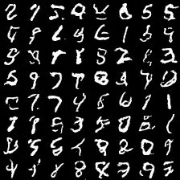
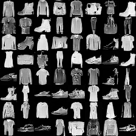

# Model Families

Every model in NanoGrad sits on the same core: `tensor.py` (tensors and
autograd), the kernels, and the layers in `tensor_nn.py`. A new family
mostly *reuses* that stack; the interesting part is what little each one
had to add. Every family is checked against PyTorch running the same
architecture from the same weights (`torch_twin.py`, or PyTorch's own
`nn.LSTM`/`nn.GRU`): in float64 they train to the same numbers.

```text
                         lenet  resnet  vit  GPT  bert  lstm/gru  vae  diffusion
conv2d                     x      x                                        x
pad / stride                      x                                        x
batch norm                        x
avg / max pooling          x
upsample                                                                   x
linear                     x      x      x    x    x       x       x       x
attention                                x    x    x
layer / RMS norm                         x    x    x
embedding (row gather)                        x    x       x
row scatter                                   x
split / concat                           x    x    x       x               x
softmax + cross entropy    x      x      x    x    x       x
BCE with logits / MSE                                              x       x
```

(The GPT's row scatter is for its optional mixture-of-experts layers.)

## Classic CNN: LeNet (`vision.py`)

Two 5x5 convolutions with tanh and average pooling, then a linear layer:
LeNet-5 (1998) at 28x28. Convolution is im2col (gather every patch into a
row through a cached index table) followed by one matrix product.

*Added to the core*: convolution, pooling (index tables + C kernels).

## Residual networks: ResNet (`resnet.py`)

`out = relu(F(x) + shortcut(x))`: each block learns a correction to its
input, which is what lets very deep networks train. F is two 3x3
convolutions with batch norm; a stride-2 block halves the image and its
shortcut becomes a 1x1 convolution.

*Added*: padding (a scatter into a zero image) and stride for
convolution, batch norm (LayerNorm's math per channel, with running
statistics for evaluation), ReLU kernel.

## Vision transformer: ViT (`vit.py`)

Cut the image into 7x7 patches, embed each as a token, add learned
positions, run transformer blocks, average the tokens, classify.

*Added*: nothing but a `causal=False` switch on attention; the patching
is a reshape and a permute.

## GPT (`language.py`, `gpt_train.py`)

The character GPT follows nanoGPT; `--preset baby-llama` swaps in LLaMA's
parts and `--tokenizer bpe` uses byte-pair encoding. See
[llm_gears.md](./llm_gears.md) and [shakespeare_gpt.md](./shakespeare_gpt.md).

*Added*: embeddings, LayerNorm, GELU, softmax, attention (all heads in
one batched product), RMSNorm, rotary embeddings, SwiGLU, KV cache,
grouped-query and sliding-window attention, mixture-of-experts
feed-forward layers (`moe.py`, which needed a row-scatter op), LoRA
adapters (`lora.py`) and weight quantization (`quantize.py`).

## Encoders: BERT (`bert.py`, `bert_finetune.py`)

The GPT block without the causal mask, trained by masked character
modeling, then fine-tuned with a small classifier head to tell which
Shakespeare character is speaking (`speakers.py`): the pretrain/fine-tune
workflow behind GLUE results.

*Added*: masking recipe, mean-pooled classifier head.

## Recurrent networks: LSTM and GRU (`rnn.py`)

Read the sequence one step at a time, carrying a hidden state; gates
decide what to keep and what to write. Training unrolls the loop and
backpropagates through every step. `gpt_train.py --preset baby-lstm` is
Karpathy's char-rnn in the GPT's recipe.

`wikitext_lm.py` runs the same LSTM as a word-level language model on
WikiText-2 with the recipe of PyTorch's own `word_language_model`
example: the state carries over from one 35-word window to the next while
gradients stop at the window edge (truncated backpropagation through
time).

On the GPU, `--data data/ptb --preset zaremba-medium` trains Zaremba et
al.'s "medium" LSTM (two layers of 650, dropout 0.5, 39 epochs) on the
Penn Treebank in 70 minutes: test perplexity **84.0** (validation 87.6;
paper 82.7 and 86.2).

*Added*: `split` (whose pieces share one gradient buffer, so splitting a
sequence into T steps stays linear in T), sigmoid kernel, LSTM state in
and out, and a fused LSTM cell (two ops with C kernels instead of a
split and seven elementwise ops per step).

## Variational autoencoder (`vae.py`, `vae_compare.py`)

Encode an image to a distribution over codes, sample a code with the
reparameterization trick, decode, and train on reconstruction + KL
divergence. Decoding random codes generates new digits.

*Added*: binary cross entropy on logits (stable form, C kernel).

## Diffusion (`diffusion.py`, `diffusion_demo.py`)

Learn to predict the noise that was added to an image at a random noise
level; generate by starting from pure noise and removing it step by step.
The network is a small U-Net: convolutions that halve the image twice and
double it back, with skip connections and a sinusoidal time embedding.

*Added*: nearest-neighbour upsampling (an index-table gather), concat
through index tables.

Sampling uses DDIM (Song et al., 2021): 100 of the 1,000 noise levels,
with the x0 estimate clipped to [-1, 1] and the step re-noised with the
noise that the clipped x0 implies (re-noising with the model's own
estimate instead lets x drift and overflow). The weights sampled from are
an EMA (decay 0.999). Sample quality is an FID on the features of a small
MNIST CNN (`sample_quality.py`; 98.8% test accuracy), so it is comparable
within this repo only, not with Inception FIDs. 1,000 real training
images score 2.4 and uniform noise 438.

```bash
NANOGRAD_THREADS=8 .venv/bin/python diffusion_demo.py --dataset mnist --dtype float32 \
    --width 32 --batch-size 128 --lr 5e-4 --epochs 20 --ema 0.999 --ddim-steps 100
```

| U-Net | parameters | FID, 1,000 samples (real images: 2.4) | time |
| --- | ---: | ---: | --- |
| width 32, 20 epochs | 404K | 24.8 | 2.8 h on 8 threads |
| + group norm and attention (`--groups 8 --attention`) | 455K | **18.1** | 4.5 h on 8 threads |

Over training (FID after 5 / 10 / 15 / 20 epochs) the second goes
118 / 48 / 27 / 18. Group norm (`--groups`) switches the residual blocks to
DDPM's order (norm, SiLU, convolution); `--attention` adds a single-head
transformer block over the 7 x 7 middle, where every position sees the
whole digit.



The same model and recipe on Fashion-MNIST (`--dataset fashion`) reaches
FID **7.3** after 20 epochs (52 / 18 / 9.8 / 7.3 after 5 / 10 / 15 / 20;
4.2 h on 8 threads). Its judge is a Fashion-MNIST CNN (89.9% test
accuracy), on whose features 1,000 real images score 0.6, so the number
is not comparable with the MNIST one.



*Added*: group norm, DDIM sampling, the clipped DDPM posterior step, an
EMA of the weights, and the FID.

## Graph networks: GCN (`gcn.py`)

Kipf and Welling's graph convolutional network on the Cora citation graph:
each layer averages every paper's features with those of the papers it
cites or is cited by, then applies a linear layer. Two layers classify
2,708 papers into 7 topics from the labels of 140. With pygcn's recipe it
reaches 83% test accuracy, trains identically to PyTorch (weights equal to
9e-13 after 200 steps), and runs 3x faster than PyTorch's sparse product
on this CPU.

*Added*: a sparse matrix (`SparseMatrix`, rows of nonzeros) and its
product with a dense matrix, a C kernel whose backward pass multiplies by
the stored transpose; Adam's L2 form of weight decay (`TensorAdam(l2=)`).

`gat.py` is the graph attention network (Velickovic et al., 2018): each
node learns how much to weight each neighbour, with 8 attention heads.
The softmax runs over each node's own neighbours (a different number for
every node) and is built from ops the core already had: gather each
edge's endpoints, exp, scatter-add the totals onto the nodes, divide.
81.6% +- 1.6 test accuracy over 5 seeds (paper: 83.0% +- 0.7), about 80
seconds per run with early stopping.

## Text classification: fastText (`text_classify.py`)

The bag-of-tricks baseline of Joulin et al. (2016) on AG News: average
the embeddings of a text's words (and, optionally, of its word pairs,
hashed into a million extra rows), then one linear layer. 91.4% test
accuracy with words, 91.8% with word pairs, trained identically to
PyTorch's `nn.EmbeddingBag`.

*Added*: nothing new for the model itself (the bag mean is a row gather
and a row scatter), but its 10.6-million-number table needed row-sparse
gradients: `tensor.RowGrad` keeps just the rows a batch used, and SGD
updates just those rows in place. One step went from 54 ms to 1.1 ms,
faster than PyTorch's sparse embedding gradients (1.7 ms).

## Reinforcement learning: CartPole (`rl.py`)

No dataset: an agent balances a pole on a cart (Gym's CartPole-v1
dynamics, rewritten in 30 lines) and learns from the rewards alone, with
the two agents of PyTorch's `examples/reinforcement_learning`. REINFORCE
makes each action more likely in proportion to the return that followed
it; actor-critic also predicts the return and weights actions by how much
better it turned out. Solved means a running return above 475 of 500:

| agent | seeds solved within 1,000 episodes | episodes to solve (median) | time per run |
| --- | ---: | ---: | ---: |
| REINFORCE | 9 of 10 | about 300 | 2-6 s |
| actor-critic | 10 of 10 | about 370 | 2-9 s |

*Added*: nothing in the core; the policy-gradient loss is a gather of the
log-probabilities of the actions taken, weighted by the returns, and a
custom Huber loss op. Tests check both agents' gradients against PyTorch.

## Time-series forecasting: DLinear and a patch transformer (`timeseries.py`)

ETTh1, the long-horizon forecasting benchmark of Informer, Autoformer,
DLinear and PatchTST: from 336 hours of 7 electricity-transformer series,
predict the next 96 to 720. DLinear splits the input into a moving-average
trend and the rest and applies one linear map to each; the moving average
is a fixed 336 x 336 matrix, so the model is three matrix products. It
reaches test MSE 0.370 at horizon 96 (paper: 0.375), trained identically
to the authors' PyTorch formulation. `--model patchtst` cuts every series
into overlapping 16-hour patches and runs them as tokens through the
language models' transformer encoder: test MSE 0.390 at horizon 96 after
8 epochs with early stopping (PatchTST paper: 0.370 with a larger model).

*Added*: nothing; both models are the core's linear layers and transformer
blocks.

## Translation: the encoder-decoder transformer (`seq2seq.py`, `translate.py`)

German to English on Multi30k (29,000 image descriptions to train on;
the 1,000-sentence test 2016 set to score), the usual first translation
benchmark. The model is the original transformer's shape: an encoder
reads the whole German sentence, and a decoder writes the English one
word by word. Each decoder block adds cross-attention, which is the
GPT's attention layer with queries from the target and keys and values
from the encoder's output. Sentences are padded to a batch's longest, and
a key mask hides the padding. Width 128, 4 heads, 2 encoder and 2
decoder blocks, dropout 0.1, label smoothing 0.1, Adam with warmup and
cosine decay, 10 epochs (about an hour):

| decoding | test 2016 BLEU |
| --- | ---: |
| greedy | 32.5 |
| beam search, width 4 | 33.4 |

*Added*: `memory=` and `key_mask=` on the attention layer (cross-attention
and padding masks), greedy and beam-search decoding, and corpus BLEU.
`translate.py --compare` runs the same steps in PyTorch through the twin.


## Link prediction: graph autoencoders (`linkpred.py`)

Hide 15% of Cora's citations and tell them apart from random unlinked
pairs. Kipf and Welling's graph autoencoder embeds every paper with a
two-layer GCN and scores a pair by the dot product of their embeddings.
It trains by reconstructing the whole 2,708 x 2,708 adjacency matrix:
7.3 million pair scores per step (one matrix product, Z Z^T), with each
real edge weighted up by the ratio of non-edges to edges. The variational
version (VGAE) samples the embeddings and adds a KL term, as the VAE does.
The authors' recipe (32 then 16 units, Adam lr 0.01, 200 full-graph steps),
5 random edge splits:

| model | test AUC | test average precision | paper |
| --- | ---: | ---: | --- |
| GAE | 91.8 | 92.6 | 91.0 / 92.0 |
| VGAE | 92.4 | 93.4 | 91.4 / 92.6 |

*Added*: nothing in the core. The edge weighting is two calls of the
existing BCE-with-logits op: one over every pair, and one over the edges
alone, gathered by position.

## Audio: spoken digits (`audio.py`)

The Free Spoken Digit Dataset: 3,000 eight-kHz recordings of 0-9 by 6
speakers, with recordings 0-4 of each speaker and digit as the test set.
Each clip becomes a 40 x 100 log-mel spectrogram: 32 ms Hann-windowed
frames every 10 ms, a power spectrum, 40 mel bands, and a log. The DFT is
written as two matrix products with cosine and sine tables, so it runs
on the same gemm as everything else. A three-block CNN (conv, batch
norm, ReLU, pooling) then classifies the spectrogram like an image: **99.33%**
test accuracy after 20 epochs (Adam, lr 1e-3), the same as PyTorch from
the same weights.

*Added*: a WAV reader (the standard library's `wave`), mel filters, and
the `MaxPool2d` module.

## Recommendation: neural collaborative filtering (`recommend.py`)

MovieLens-1M as the NCF paper splits it: every user's latest movie is
held out, and the model must rank it among 99 movies that user never
rated (HR@10: is it in the top 10? NDCG@10 also rewards a higher rank).
Each user and movie gets a learned vector. GMF scores a pair by an
elementwise product of the two vectors; MLP puts the vectors side by side
through ReLU layers; NeuMF concatenates both and adds a final layer.
Training samples 4 unwatched movies per watched one, every epoch, with
Adam and binary cross entropy. 32 factors, MLP 256-128-64-32, 20 epochs:

| model | HR@10 | NDCG@10 | reference |
| --- | ---: | ---: | --- |
| GMF | 0.710 | 0.426 | PyTorch reproduction: 0.708 / 0.429 |
| MLP | 0.691 | 0.419 | NCF authors' code: 0.692 / 0.425 |
| NeuMF | 0.695 | 0.421 | 0.701 / 0.425 |
| NeuMF, pre-trained from GMF + MLP | 0.698 | 0.429 | 0.726 / 0.445 |

GMF and MLP land on the published numbers, and plain NeuMF is within one
point of them. Pre-training NeuMF from the trained GMF and MLP helps a
little here (0.695 -> 0.698), not the 2.5 points the paper reports. The
fine-tuning stage is plain SGD at lr 0.001, as in the reproduction; from
our pre-trained parts it peaks early and then slowly overfits.

*Added*: nothing in the core: embeddings are row gathers, and the pair
losses are the existing BCE with logits.

## Uncertainty: MC dropout on UCI regression (`uci.py`)

Gal and Ghahramani showed that keeping dropout on at test time and
averaging many stochastic passes approximates a Bayesian network's
predictive distribution. The UCI benchmark (Hernandez-Lobato and Adams)
measures it: 9 small regression tables, fixed 90/10 splits, test RMSE and
predictive log-likelihood. The protocol follows Gal's code: a grid search
over the dropout rate and tau on a held-out fifth of each training split,
a 50-unit ReLU layer, and 10,000 MC samples at test time. Training is 400
epochs (Gal's code's 40 x 10); the three larger tables use 5 of their 20
splits (protein was not run):

| dataset | RMSE | log-likelihood | paper RMSE | paper log-likelihood |
| --- | ---: | ---: | ---: | ---: |
| Boston | 3.15 +- 0.20 | -2.57 +- 0.07 | 2.97 | -2.46 |
| concrete | 5.42 +- 0.12 | -3.09 +- 0.02 | 5.23 | -3.04 |
| energy | 1.54 +- 0.05 | -1.87 +- 0.04 | 1.66 | -1.99 |
| kin8nm | 0.084 +- 0.002 | 1.07 +- 0.02 | 0.10 | 0.95 |
| naval | 0.002 +- 0.000 | 4.35 +- 0.01 | 0.01 | 3.80 |
| power plant | 4.11 +- 0.08 | -2.83 +- 0.02 | 4.02 | -2.80 |
| wine (red) | 0.627 +- 0.008 | -0.95 +- 0.01 | 0.62 | -0.93 |
| yacht | 2.89 +- 0.23 | -2.28 +- 0.07 | 1.11 | -1.55 |

(+- is the standard error over splits, as the paper reports.) Energy, kin8nm
and naval beat the paper; Boston, concrete, power plant and wine come
within a few percent of it. Yacht, the smallest table (308 rows, three Adam
steps per epoch), is far from converged at 400 epochs.

Gal's published result files (the DropoutUncertaintyExps repository) were
made with 100x the epochs, 4,000, and his code's default is 500x. Run that
way (`--epoch-multiplier 100`, 17 minutes), yacht matches them within the
standard error:

| yacht, 4,000 epochs | RMSE | log-likelihood |
| --- | ---: | ---: |
| NanoGrad, 20 splits | 0.705 +- 0.045 | -1.257 +- 0.014 |
| Gal's result files | 0.666 +- 0.049 | -1.25 +- 0.015 |

*Added*: nothing in the core. MC dropout is ordinary dropout left on, and
10,000 samples run as one batch of repeated rows (in chunks).

## Normalizing flows: MADE and MAF (`flow.py`)

An exact-likelihood generative model: an invertible map from images to
Gaussian noise, trained on log p(x) = log N(f(x)) + log |det df/dx|.
MADE masks an MLP's weights so each output pixel sees only earlier
pixels, which makes the Jacobian triangular and its determinant a sum.
MAF stacks MADEs in alternating orders with batch norm between them (a
flow layer with its own log-determinant). Dequantized MNIST in logit
space, as in the MAF paper. MAF(5) with 1,024 hidden units per MADE, Adam
at 1e-4, batch 100, 20 epochs:

| model | test log-likelihood (nats, logit space) | bits / dim (pixel space) |
| --- | ---: | ---: |
| MADE, here | -1351.2 | 1.99 |
| MADE, MAF paper | -1380.8 | |
| MAF(5), here | **-1217.6** | 1.74 |
| MAF(5), MAF paper | -1300.5 | |

Higher log-likelihood is better. Stacking five MADEs with batch norm gains
134 nats over one (80 in the paper). MAF here also starts each MADE as the
identity (zero output layers), which keeps the first steps stable on logit
pixels that span about +-14.

*Added*: masked linear layers (a weight times a fixed 0/1 mask) and a
batch-norm flow layer with its log-determinant. A calibration pass then
sets the batch-norm statistics from training data before evaluation, as
MAF does.

## Super-resolution: SRCNN (`sr.py`)

Three convolutions turn a bicubic-upscaled image into a sharp one. SRCNN's
protocol (Y channel, 3 border pixels shaved, PSNR in dB) depends on
MATLAB's `imresize`, which is reimplemented exactly here. As a check,
bicubic upscaling alone scores the 30.39 dB (Set5) and 27.54 dB (Set14)
that every super-resolution paper lists. SRCNN 9-1-5 at x3, trained on the
91-image set (21,884 patches of 33 x 33) for 50 epochs with Adam at 1e-4:

| | Set5 | Set14 |
| --- | ---: | ---: |
| bicubic | 30.39 dB | 27.54 dB |
| SRCNN 9-1-5, here | **32.11 dB** | **28.80 dB** |
| SRCNN 9-1-5, paper (91 images) | 32.39 dB | 29.00 dB |

The paper trains for about 10^8 patch steps with SGD; this is 50 epochs,
about 70,000 steps, and still improving slowly at the end.

*Added*: separable bicubic resizing with MATLAB's kernel, antialiasing
and mirrored edges. Large test images are evaluated in overlapping strips,
which gives the same result without one multi-GB patch table.

## Few-shot learning: prototypical networks (`fewshot.py`)

Classify new Omniglot characters from 1 or 5 examples each. A
four-block CNN embeds every image. Each class's prototype is the mean
embedding of its examples, and a query goes to the nearest prototype.
Training runs on random 60-way episodes that mimic the test: 5,000 1-shot
episodes with Adam at 1e-3, halved every 2,000. Test accuracy is over 1,000
random episodes of new characters, with 15 queries per class:

| | 5-way 1-shot | 5-way 5-shot | 20-way 1-shot | 20-way 5-shot |
| --- | ---: | ---: | ---: | ---: |
| here | 98.3% | 99.6% | 94.4% | 98.6% |
| prototypical networks paper | 98.8% | 99.7% | 96.0% | 98.9% |

One model, trained with 1-shot episodes, is tested at both shot counts;
the paper trains a separate model for each. The test set embeds once (in
evaluation mode, batch norm does not depend on the batch), so 1,000
episodes are distance computations on cached vectors.

*Added*: a PNG decoder (`images.py`) and the `MaxPool2d` module. The
prototype distances are a matrix product and two row sums:
||q - c||^2 = ||q||^2 - 2 q . c + ||c||^2.

## Adversarial robustness: FGSM, PGD and fast adversarial training (`adversarial.py`)

Attacks move every pixel by at most 0.3 along the sign of the loss
gradient with respect to the input image: one step (FGSM), or 50 steps
with random restarts (PGD). The defence is Wong et al.'s "fast"
adversarial training, which trains on FGSM examples from a random start.
Their MNIST recipe is a small CNN, 10 epochs, eps 0.3, step 0.375, with
evaluation by PGD-50 from 10 random starts on the full test set:

| model | clean | FGSM | PGD-50 x 10 |
| --- | ---: | ---: | ---: |
| fast adversarial training, PyTorch-style initialization | 97.95% | 92.80% | **75.81%** |
| the same, Xavier-initialized linear layers | 97.63% | 97.16% | 0.00% |
| Wong et al.'s recipe run in plain PyTorch (1,000 images, 1 restart) | 98.70% | | 88.80% |

The second row is "catastrophic overfitting": the model learns to make
the single FGSM step useless instead of becoming robust. FGSM accuracy
looks excellent, but PGD breaks it completely. How the layers are
initialized decides which way training goes, so `small_cnn` initializes
as PyTorch does.

The 88.80% above was measured on an easier test (1,000 images, one
start), so it is not comparable. To compare like with like, five
NanoGrad seeds (`adversarial.py --seed N`) and three seeds of a separate
plain-PyTorch version of Wong et al.'s published code (their
`train_mnist.py` and `evaluate_mnist.py` on the CPU, float32, PyTorch's
own initialization and shuffling) were each scored with the full test:
PGD-50 from 10 starts on all 10,000 test images. These runs were on an
8-core Ryzen 7 3700X; seed 0 lands on a different number from the table
above (81.30% instead of 75.81%) because that machine's AVX2 products
round differently from the AVX-512 machine's, and this training
amplifies the difference.

| seed | NanoGrad clean | NanoGrad PGD-50 x 10 | PyTorch clean | PyTorch PGD-50 x 10 |
| --- | ---: | ---: | ---: | ---: |
| 0 | 98.00% | 81.30% | 98.45% | 85.40% |
| 1 | 98.29% | 69.29% | 97.26% | 0.00% (collapsed) |
| 2 | 98.54% | 85.29% | 98.10% | 86.43% |
| 3 | 98.60% | 76.16% | | |
| 4 | 98.58% | 86.48% | | |

The two frameworks overlap: NanoGrad's runs land between 69% and 86%,
and PyTorch's between 85% and 86%, plus one catastrophic collapse to
0%. The seed is what decides the result, not the framework, so the gap
to the 88.80% figure is not a NanoGrad bug. With a handful of seeds each,
the means cannot be told apart either way. Neither framework reaches
Wong et al.'s reported 89% on these seeds.

*Added*: input gradients (an input tensor with `requires_grad`) and a
`projected_sign_step` kernel: the sign step and both clips (the eps-box
and the [0, 1] pixel range) in one pass.

## Knowledge distillation (`distill.py`)

Hinton et al.'s MNIST experiment: a large teacher (two 1,200-unit layers,
dropout, jittered inputs) and a small student (two 800-unit layers)
trained alone or on the teacher's predictions softened at T = 20. Every
network gets 20 epochs of Adam; the paper trains far longer:

| model | test errors (of 10,000) | paper |
| --- | ---: | ---: |
| teacher, 2 x 1,200, dropout + jitter | 163 | 67 |
| student, 2 x 800, alone | 176 | 146 |
| student, distilled at T = 20 | **159** | 74 |

The distilled student beats the same network trained alone from the
same weights, and here even its teacher: 20 epochs are not enough for
dropout and jitter to pay off, but the teacher's soft targets still
carry what it learned about similar digits.

*Added*: `losses.soft_cross_entropy`, cross entropy against target
distributions (gradient: softmax - targets).

## Segmentation: a U-Net on CamVid (`segment.py`)

Per-pixel classification of street scenes into 11 classes. An
encoder-decoder with skip connections (transposed convolutions and
concatenation) is trained on the 367 SegNet training frames at half
resolution. Reported: global accuracy, class-average accuracy and mean
IoU on the 233 test frames. 20 epochs of Adam (lr 1e-3, batch 4, random
flips), float32, plain cross entropy:

| global accuracy | class average | mean IoU |
| ---: | ---: | ---: |
| 81.6% | 45.7% | 36.9% |

Per class IoU: sky 88, road 87, building 69, pavement 62, tree 53, car 39,
sign 6, pole 1, fence 0, pedestrian 0, bicyclist 0. The large classes are
learned well. The thin and rare ones are not: poles, pedestrians and
cyclists are a few percent of the pixels, and unweighted cross entropy
ignores them. SegNet weights the loss by inverse class frequency for this
reason ("median frequency balancing"), which mainly raises the class
average. With it (`--balance`), the same run trades pixels of the big
classes for the small ones:

| loss | global accuracy | class average | mean IoU |
| --- | ---: | ---: | ---: |
| plain cross entropy | 81.6% | 45.7% | 36.9% |
| median frequency balancing | 68.5% | 60.5% | 36.2% |

Balanced, per class IoU: sky 89, building 35, pole 11, road 85, pavement 56, tree 47, sign 8, fence 11, car 36, pedestrian 13, bicyclist 8. Class average accuracy
rises 15 points, global accuracy falls 13, and mean IoU stays about the
same: the rare classes are now found, at the cost of false alarms on the
common ones.

*Added*: nothing in the core. Skip connections are `concat` along the
channel axis, upsampling is the existing transposed convolution, and the
void label is skipped by gathering the labelled pixels' rows before the
cross entropy.

## Keyword spotting: DS-CNN on Speech Commands (`kws.py`)

MLPerf Tiny's audio benchmark: 12 classes (10 commands, unknown and
silence) from one-second clips, using 49 x 10 MFCCs. The model is a
MobileNet with a 10 x 4 stride-2 stem: the same `mobilenet.py`, with
different arguments. Trained for 24 epochs with Adam (the reference's
learning rates), without its dropout, it reaches **90.33%** on the
official 4,890-clip test set. MLPerf Tiny's quality target is 90%; the
reference DS-CNN gets about 92%. With the reference's regularization,
dropout and an L2 penalty on the convolution kernels, and its 36 epochs,
NanoGrad's DS-CNN gets there too: **92.09%**
(`kws.py --epochs 36 --dropout --l2 1e-4`).

How the gap closed:

| run | test accuracy |
| --- | ---: |
| 24 epochs (above) | 90.33% |
| 24 epochs, `--augment` (fresh time shifts and noise every epoch) | 87.59% |
| 36 epochs (the reference's count) | 90.10% |
| 36 epochs, `--all-unknown` (the reference's training data) | 87.77% |
| 36 epochs, `--all-unknown --dropout` (its data and dropout) | 90.39% |
| 36 epochs, `--dropout --l2 1e-4` (its dropout and L2) | **92.09%** |

The reference's code asks for random time shifts and background noise,
but draws them with NumPy inside the function it gives tf.data's `map`,
which runs once, when the graph is built: the shift is a constant
pad-and-slice that changes nothing, and every training clip gets the same
noise slice at the same volume. So its 92% does not come from
augmentation. Real augmentation, as in TensorFlow's original
speech_commands example, cost 2.7 points here at 24 epochs (training
loss still 0.28: the 23K-parameter model underfits the harder data), and
more epochs alone overfit (training loss 0.07). What the reference does
have is more data: TensorFlow Datasets' training split labels every
other word's clip "unknown", 85,511 clips against our 36,921 (unknown
words subsampled to 10% of the keyword clips); `--all-unknown` gives
87,919. It also has dropout (0.2 after the stem, 0.4 before pooling,
`--dropout`) and L2 1e-4.

The data does not close the gap: all the unknown words alone cost 2.3
points (58% of those training clips are "unknown", while the official
test set has the 12 classes balanced), and dropout only wins them back.
The regularization does: dropout plus L2 on the subsampled data gives
92.09%, with every class between 86.0% (unknown) and 96.4% ("yes"):
silence 92.6, unknown 86.0, yes 96.4, no 94.1, up 93.2, down 88.9,
left 93.4, right 93.7, on 91.7, off 92.5, stop 92.5, go 89.8.

*Added*: separate row and column padding in `conv2d` / `pad2d` (the
10 x 4 stem), and MFCCs: the log-mel spectrogram followed by a DCT, both
matrix products.

### Listening live (`kws_live.py`)

The same model, on the microphone. `kws.py --save` writes a checkpoint
(the weights plus the training set's MFCC statistics); `kws_live.py`
streams 16 kHz samples from ALSA's `arecord`, classifies the last
second every 125 ms, and prints a word when its probability, averaged
over 3 windows, reaches 0.7. Then it waits 1 s, and until that word has
faded, so one utterance prints once. Windows that are not 6 dB above the
noise floor (the quietest hop of the last 4 s) skip the model. One
window takes about 4 ms, so it runs 30 times faster than real time.

```text
python3 kws.py --epochs 36 --dropout --l2 1e-4 --save runs/kws/model.json
python3 kws_live.py --device plughw:1,0          # arecord -l lists the cards
python3 kws_live.py --device plughw:1,0 --verbose # every window's level and class
```

Without a microphone, `--wav` runs the same detector over a file, and
`--make-test-wav` builds one from test-set clips with a second of
silence between them. On a stream of 145 clips (100 keywords, 45 unknown
words and silence), words printed right out of 100, and false alarms:

| model | clean | + a webcam's room noise |
| --- | ---: | ---: |
| dropout + L2 (92.09%) | 90, 4 | 71, 4 |
| `--augment`, 24 epochs (87.59%) | 88, 4 | 79, 1 |

The room noise (2 s recorded through the webcam, RMS 0.011, looped under
the clips) costs the best clip classifier 19 words; the one trained with
background noise mixed into its clips loses 9. So for the microphone,
`kws.py --epochs 24 --augment --save runs/kws-augment/model.json` and
`kws_live.py --model runs/kws-augment/model.json` may be the better pair.

## Mobile networks: MobileNet (`mobilenet.py`)

Depthwise-separable convolutions: a 3 x 3 filter per channel, then a
1 x 1 convolution that mixes channels, about 8x fewer multiplications
than a full 3 x 3 convolution. On CIFAR-10, 3 epochs of Adam: **66.61%**
test accuracy, the same in PyTorch from the same weights (weights equal
to 4e-12 after training), at 207 vs 206 ms per step. The same module,
with a 10 x 4 stride-2 stem, is the DS-CNN of keyword spotting.

*Added*: `depthwise_conv2d` (one kernel per channel) and its C kernels.

## GANs: a DCGAN on MNIST (`gan.py`)

A generator (transposed convolutions from 100 random numbers to a 28 x 28
image) and a discriminator (strided convolutions to one score) trained
against each other, with DCGAN's recipe (Adam at 2e-4, beta1 0.5, batch
norm, LeakyReLU). After 5 epochs the losses settle near the equilibrium
(discriminator 0.77, generator 1.60), and the samples in
`runs/gan/samples_epoch*.png` are recognizable digits. `gan.py --compare`
runs 20 steps in both frameworks: identical losses, weights equal to
7e-16.

*Added*: `conv_transpose2d` (the convolution kernels with input and
output roles swapped), `LeakyReLU` and `Tanh` modules.

## Sequence regression: sine waves with L-BFGS (`sine.py`)

PyTorch's `time_sequence_prediction` example: a 2-layer LSTM learns to
continue sine waves, trained full-batch with L-BFGS (15 steps). Test MSE
after training: 4.98e-6 in NanoGrad, 5.01e-6 in PyTorch from the same
weights. Fed its own predictions, it then continues the 3 test waves for
1,000 more samples with mean squared error 0.011.

*Added*: `TensorLBFGS`, a port of `torch.optim.LBFGS` (without line
search).

## Sequential MNIST with an LSTM (`mnist_compare.py --model lstm`)

Each 28 x 28 digit is read as 28 rows, one time step each, by a 128-unit
LSTM, and its last state is classified. 3 epochs of Adam: **97.67%**
test accuracy (PyTorch, same weights: 96.80%; the runs drift apart over
thousands of steps, because the fused gate kernels round differently).


## Sequence labeling: a BiLSTM-CRF tagger (`tagger.py`)

Part-of-speech tagging on Universal Dependencies' English Web Treebank
(12.5K training sentences, 17 universal tags), scored as the share of
test words tagged right. Each word is three embeddings joined together
(the lowercased word, its last three letters, and its shape: lowercase,
Capitalized, UPPER or with digits); a BiLSTM reads the sentence both
ways, and a linear layer gives one score per tag. On top sits a
linear-chain CRF (Huang et al., 2015; Lample et al., 2016), which scores
whole tag sequences with learned transition scores. Its normalizer is the
forward algorithm, `alpha_t[j] = logsumexp_i(alpha_t-1[i] + trans[i, j]) + e[t, j]`,
written as a small matrix product of `e^alpha` and `e^trans` per word,
shifted to stay in range; decoding is Viterbi. Sentences are batched by
length, so there is no padding to mask.

15 epochs of Adam with dropout 0.5, test accuracy at the best epoch on
dev:

| output layer | dev | test |
| --- | ---: | ---: |
| softmax per word | 94.04% | 94.45% |
| CRF | 94.32% | 94.66% |
| CRF + character BiLSTM | 94.62% | **94.83%** |

The model has no pretrained word vectors; the CRF's transitions add 0.2
points over a softmax per word. `--chars` adds Lample et al.'s character
model: a BiLSTM over each word's letters (25-dimensional letter
embeddings, 25 units each way), run once per distinct word in a batch,
with words grouped by length so nothing is padded; its two final states
join the word's embeddings. It sees whole prefixes and suffixes, and the
spelling of words too rare for an embedding of their own. Over two seeds
it adds 0.3 points on both dev and test:

| seed | CRF dev / test | + characters dev / test |
| --- | ---: | ---: |
| 0 | 94.32 / 94.66 | 94.62 / 94.83 |
| 1 | 94.44 / 94.62 | 94.69 / 95.06 |
| mean | 94.38 / 94.64 | 94.66 / **94.95** |

An epoch took 2.3x as long (166 vs 72 ms per step), almost all of it
the many small per-letter LSTM steps; with the whole LSTM layer as one
op (`rnn.lstm_sequence`) and the CRF's forward algorithm as another
(`tagger.crf_forward`, see [performance.md](./performance.md)) a step
is 75.5 vs 40.4 ms. The PyTorch twin runs the same
character model and agrees to 1e-10 (`test_tagger.py`).

*Added*: `logsumexp` (the lane's largest value as a constant shift, so
the gradient that comes out is the softmax).
